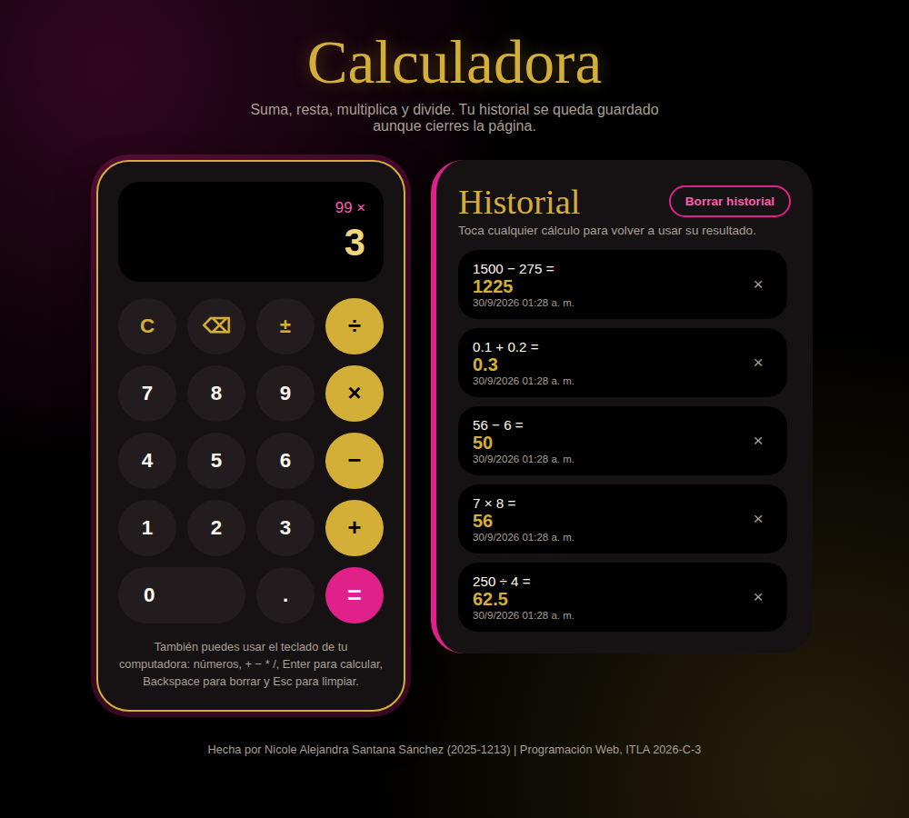

# Calculadora Web 🧮

**Tarea 2 de Programación Web (ITLA, 2026-C-3)**
Hecha por Nicole Alejandra Santana Sánchez, matrícula 2025-1213.

Esta es una calculadora hecha con HTML5, CSS3 y JavaScript ES5. Hace las cuatro operaciones básicas (suma, resta, multiplicación y división) y guarda un historial de todos los cálculos usando `localStorage`, o sea que si cierras la página y vuelves, el historial sigue ahí hasta que tú decidas borrarlo.

## Captura de pantalla



## ¿Qué hace?

- Suma, resta, multiplica y divide, y también deja encadenar operaciones (por ejemplo `7 × 8 − 6`).
- Guarda cada cálculo en el historial con la fecha y la hora, usando `localStorage`.
- Puedes borrar todo el historial con un botón (te pide confirmación primero) o quitar un solo cálculo con la ✕.
- Si tocas un cálculo del historial, su resultado vuelve a la pantalla para seguir usándolo.
- Funciona también con el teclado de la computadora: números, `+ - * /`, `Enter` para calcular, `Backspace` para borrar y `Esc` para limpiar.
- Si intentas dividir entre cero te avisa en vez de mostrar `Infinity`.
- Arregla los decimales raros de JavaScript, así que `0.1 + 0.2` da `0.3` y no `0.30000000000000004`.
- Se adapta al celular.

## ¿Cómo está organizado?

```
calculadora-web/
├── index.html          → la estructura de la página
├── css/
│   └── estilos.css     → los colores (negro, dorado y fucsia) y el diseño
├── js/
│   └── calculadora.js  → la lógica de la calculadora y el historial
├── captura.png
└── README.md
```

## ¿Cómo lo abro?

Solo descarga el repositorio y abre `index.html` en tu navegador. No hace falta instalar nada.
